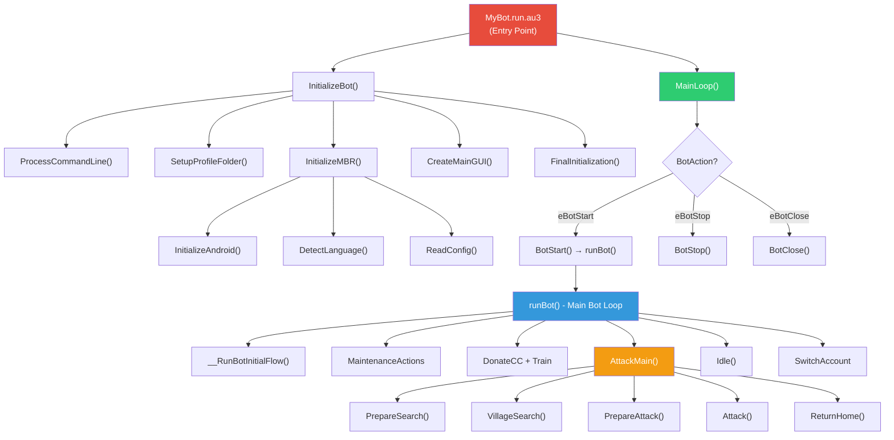
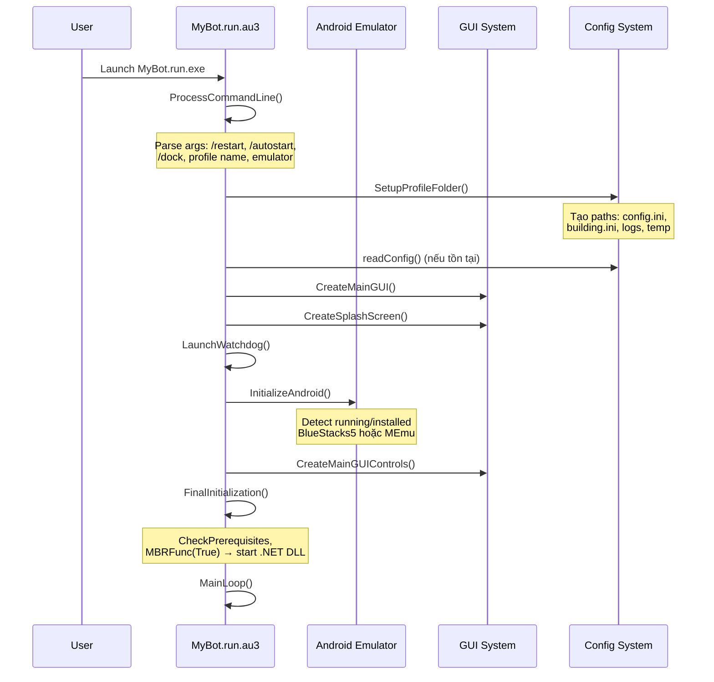
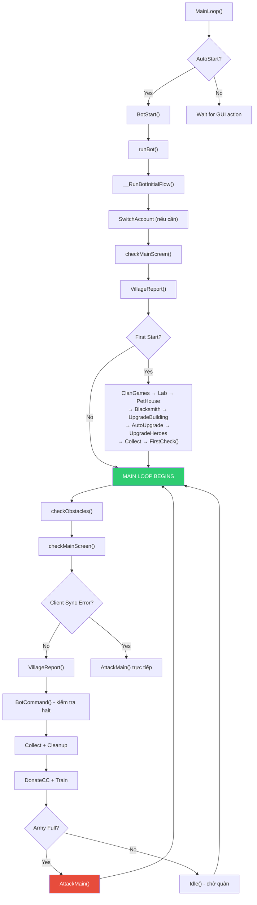
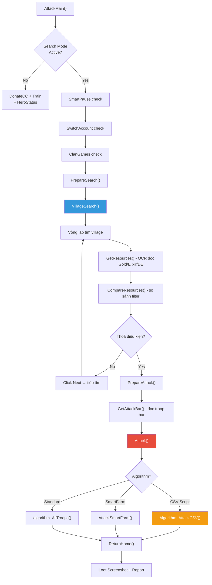
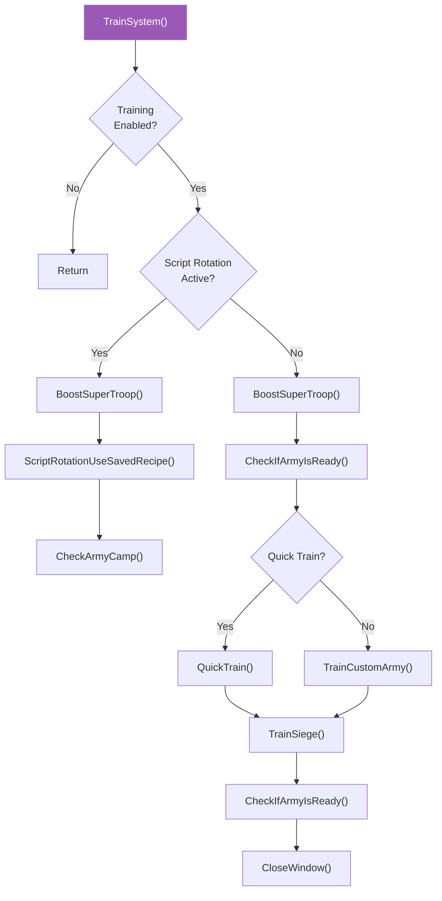
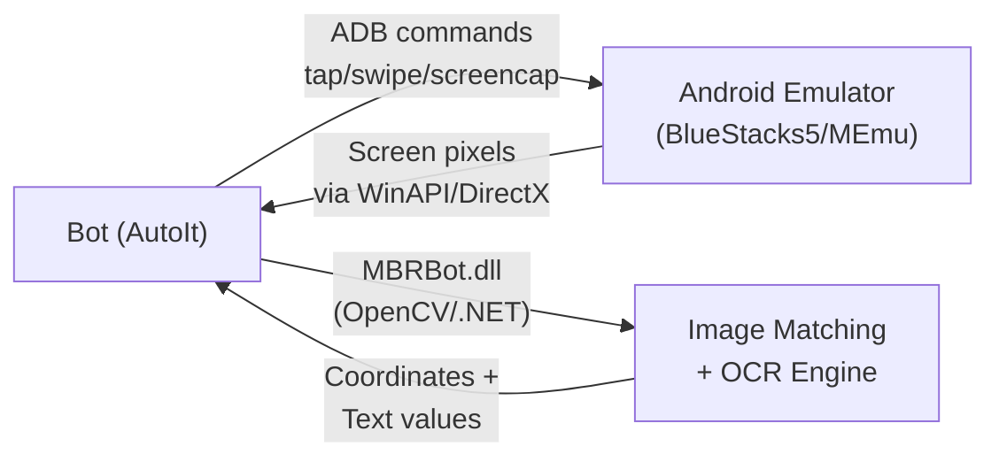
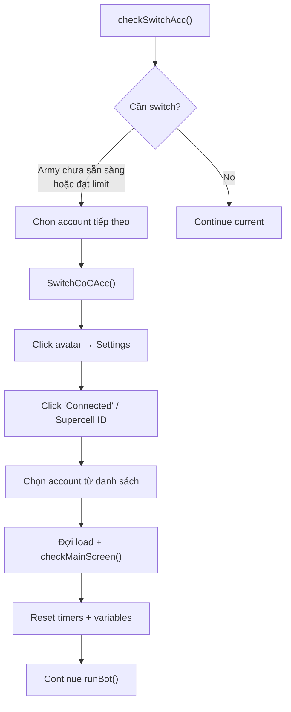
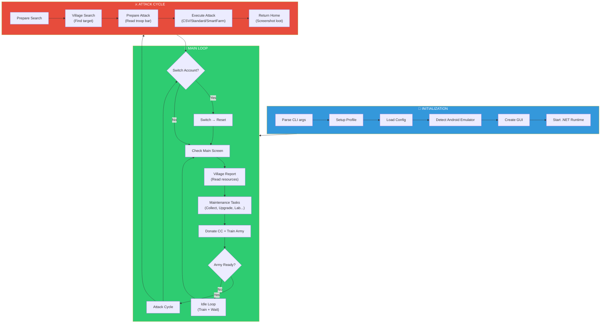

# MyBot PHMOD v15.3 - Phân Tích Kiến Trúc & Luồng Hoạt Động

> [!IMPORTANT]
> Đây là tài liệu phân tích toàn diện dự án **MyBot PH MOD v15.3** - một bot tự động hóa game **Clash of Clans** viết bằng **AutoIt3**, chạy trên Windows, điều khiển game thông qua Android Emulator.

---

## 1. TỔNG QUAN DỰ ÁN

| Thuộc tính | Giá trị |
|---|---|
| **Tên** | MyBot PH MOD v15.3 |
| **Ngôn ngữ** | AutoIt3 (scripting language trên Windows) |
| **Mục đích** | Bot tự động chơi Clash of Clans |
| **Platform** | Windows + Android Emulator (BlueStacks5, MEmu) |
| **License** | GNU GPL |
| **Base project** | [MyBot.run](https://github.com/MyBotRun/MyBot) (community bot) |
| **Phiên bản gốc** | MBR (MyBotRun) - phát triển từ 2014-2025 |

---

## 2. KIẾN TRÚC TỔNG THỂ



---

## 3. CẤU TRÚC THƯ MỤC

```
MyBot/
├── MyBot.run.au3              # 🔴 ENTRY POINT - Khởi tạo + Main Loop
├── MyBot.run.version.au3      # Phiên bản
├── MyBot.run.MiniGui.au3      # Giao diện thu gọn
├── MyBot.run.Watchdog.au3     # Giám sát process
├── MyBot.run.Wmi.au3          # Windows Management
├── MultiBot.au3               # Chạy nhiều bot
│
├── COCBot/                    # 🟢 CORE SOURCE CODE
│   ├── MBR Global Variables.au3   # ~2400 dòng biến toàn cục
│   ├── MBR Functions.au3          # Include tất cả functions
│   ├── MBR References.au3         # Reference map (chống strip)
│   ├── MBR GUI Design.au3         # Thiết kế GUI chính
│   ├── MBR GUI Control.au3        # Xử lý sự kiện GUI
│   ├── MBR GUI Action.au3         # Action handlers
│   ├── MBR GUI Control Variables.au3
│   │
│   ├── GUI/                       # 60 file GUI design + control
│   │   ├── MBR GUI Design *.au3   # Layout/Controls
│   │   └── MBR GUI Control *.au3  # Event handlers
│   │
│   └── functions/                 # 🔵 LOGIC CHÍNH
│       ├── Android/               # Điều khiển Android Emulator
│       ├── Attack/                # Thuật toán tấn công
│       ├── Config/                # Đọc/ghi cấu hình
│       ├── CreateArmy/            # Huấn luyện quân
│       ├── Image Search/          # Nhận dạng hình ảnh
│       ├── Main Screen/           # Kiểm tra màn hình chính
│       ├── Other/                 # Tiện ích (Click, Sleep, Log...)
│       ├── Pixels/                # Phân tích pixel
│       ├── Read Text/             # OCR đọc text
│       ├── Search/                # Tìm kiếm village
│       └── Village/               # Quản lý village
│
├── CSV/Attack/                # Script tấn công CSV (PHMOD)
│   ├── PHMOD-DragLoon.csv
│   ├── PHMOD-MeteorMayhem.csv
│   ├── PHMOD-Thrower Smash.csv
│   └── PHMOD-TroopSpam.csv
│
├── Profiles/                  # Profile người dùng
├── Strategies/                # Chiến thuật
├── Languages/                 # Đa ngôn ngữ
├── images/                    # Hình ảnh bot
├── imgxml/                    # Image templates cho matching
└── lib/                       # DLL + OCR data
    ├── MBRBot.dll             # Core image processing (C#/.NET)
    ├── MyBot.run.dll          # Bot runtime (.NET)
    ├── opencv_*.dll           # OpenCV cho image matching
    ├── listSymbols_*.xml      # OCR symbol databases
    ├── adb/                   # Android Debug Bridge
    └── curl/                  # HTTP client
```

---

## 4. LUỒNG HOẠT ĐỘNG CHI TIẾT

### 4.1 Khởi Động (Initialization Flow)



### 4.2 Vòng Lặp Chính (Main Loop)



### 4.3 Luồng Tấn Công (Attack Flow)



### 4.4 Hệ Thống Huấn Luyện (Training System)



---

## 5. CÁC MODULE CHÍNH VÀ CHỨC NĂNG

### 5.1 Android Control (`functions/Android/`)

| File | Chức năng |
|---|---|
| `Android.au3` (249KB) | Core: Khởi tạo, kết nối, điều khiển emulator |
| `AndroidBluestacks5.au3` | Adapter cho BlueStacks 5 |
| `AndroidMEmu.au3` | Adapter cho MEmu |
| `AndroidEmbed.au3` | Dock emulator vào bot window |
| `ZoomOut.au3` | Zoom camera game |
| `getBSPos.au3` | Lấy vị trí cửa sổ emulator |
| `Close_OpenCoC.au3` | Đóng/mở game CoC |

**Giao tiếp với Emulator:**
- **ADB (Android Debug Bridge)**: Gửi lệnh tap, swipe, screencap
- **DirectX/WinAPI**: Capture màn hình, gửi mouse click
- **Shared Memory**: Đọc pixel trực tiếp từ emulator

### 5.2 Image Recognition (`functions/Image Search/`, `functions/Pixels/`)

| File | Chức năng |
|---|---|
| `QuickMIS.au3` | Multi-Image Search - tìm nhiều ảnh trong 1 vùng |
| `imglocAuxiliary.au3` | Image location helper functions |
| `imglocTHSearch.au3` | Tìm Town Hall |
| `checkDeadBase.au3` | Kiểm tra base "chết" (collectors đầy) |
| `CheckTombs.au3` | Phát hiện mộ/cây |
| `_CaptureRegion.au3` | Chụp vùng màn hình |
| `_CheckPixel.au3` | Kiểm tra pixel tại tọa độ |
| `_PixelSearch.au3` | Tìm pixel theo màu |

**Công nghệ:**
- **Template Matching** qua `MBRBot.dll` (OpenCV C#/.NET)
- **OCR** qua XML symbol databases (`listSymbols_*.xml`)
- **Pixel Color Check** cho detection nhanh
- Ảnh template lưu trong `imgxml/`

### 5.3 OCR System (`functions/Read Text/`)

| File | Chức năng |
|---|---|
| `getOcr.au3` (44KB) | Core OCR engine - đọc text từ game |
| `getBuilderCount.au3` | Đọc số builder khả dụng |
| `getShieldInfo.au3` | Đọc thời gian shield |
| `BuildingInfo.au3` | Đọc thông tin building |

OCR sử dụng **symbol matching** với ~80+ XML database files trong `lib/` cho các loại text khác nhau (loot, time, building name, troop, spell...).

### 5.4 Attack System (`functions/Attack/`)

| Thành phần | File(s) | Mô tả |
|---|---|---|
| **Attack Algorithms** | `algorithm_AllTroops.au3` | Standard: thả toàn bộ quân |
| | `AttackFromCSV.au3` | CSV Script: đọc file CSV để tấn công |
| | `SmartFarm.au3` | SmartFarm: phân tích vị trí collector |
| **Red Area** | `_GetRedArea.au3` | Phát hiện vùng đỏ (vùng thả quân) |
| | `DropTroop.au3` | Logic thả quân tại tọa độ |
| | `GetPixelSide.au3` | Xác định cạnh base |
| **Troops** | `dropHeroes.au3` | Thả + kích hero ability |
| | `CheckHeroesHealth.au3` | Theo dõi HP hero |
| | `LaunchTroop.au3` | Chọn + thả troop |
| **CSV Parser** | `ParseAttackCSV.au3` | Parse file CSV thành lệnh tấn công |
| | `DropTroopFromINI.au3` | Thả troop theo CSV instruction |
| **Builder Base** | `PrepareAttackBB.au3` | Chuẩn bị tấn công BB |
| | `AttackBB.au3` | Tấn công Builder Base |
| **Special** | `SmartZap.au3` | Zap DE storage bằng lightning |
| | `AttackCycle.au3` | Vòng lặp tấn công liên tục |

### 5.5 Village Management (`functions/Village/`)

| File | Chức năng |
|---|---|
| `Collect.au3` | Thu thập tài nguyên |
| `DonateCC.au3` (95KB) | Hệ thống donate quân cho clan |
| `Laboratory.au3` | Nâng cấp phòng thí nghiệm |
| `PetHouse.au3` | Nâng cấp pet |
| `Blacksmith.au3` | Nâng cấp equipment |
| `UpgradeBuilding.au3` | Nâng cấp công trình |
| `UpgradeHeroes.au3` (71KB) | Nâng cấp hero |
| `UpgradeWall.au3` | Nâng cấp tường |
| `Auto Upgrade.au3` | Tự động nâng cấp |
| `SwitchAccount.au3` (37KB) | Chuyển đổi tài khoản |
| `RequestCC.au3` | Xin quân clan |
| `VillageReport.au3` | Báo cáo tài nguyên village |
| `ClanCapital.au3` (84KB) | Quản lý Clan Capital |
| `Notify.au3` (60KB) | Thông báo Telegram |
| `SwitchBetweenBases.au3` | Chuyển Main/Builder Base |
| `HelperHut.au3` | Helper Hut management |

### 5.6 Search System (`functions/Search/`)

| File | Chức năng |
|---|---|
| `VillageSearch.au3` | Vòng lặp tìm village |
| `GetResources.au3` | OCR đọc Gold/Elixir/DE/Trophies |
| `CompareResources.au3` | So sánh với filter (min/max) |
| `IsSearchAttackEnabled.au3` | Kiểm tra điều kiện tìm |
| `IsSearchModeActive.au3` | Kiểm tra mode search |
| `PrepareSearch.au3` | Chuẩn bị search |
| `WeakBase.au3` | Đánh giá base yếu |
| `WaitForClouds.au3` | Chờ hết cloud |
| `multiSearch.au3` | Tìm nhiều mục tiêu |

### 5.7 Config System (`functions/Config/`)

| File | Chức năng |
|---|---|
| `readConfig.au3` (103KB) | Đọc config từ `config.ini` |
| `saveConfig.au3` (67KB) | Lưu config |
| `applyConfig.au3` (127KB) | Áp dụng config vào GUI + biến |
| `ScreenCoordinates.au3` | Tọa độ cố định trên màn hình |
| `ImageDirectories.au3` | Paths đến ảnh template |
| `DelayTimes.au3` | Thời gian delay các action |

### 5.8 GUI System (`COCBot/GUI/`)

- **60 files** cho giao diện bot
- Tabs: Attack (Deadbase/Activebase), Village (Donate/Upgrade/Misc), Bot (Profiles/Options/Stats)
- Sử dụng AutoIt native GUI controls

---

## 6. CƠ CHẾ HOẠT ĐỘNG CỐT LÕI

### 6.1 Tương Tác Với Game



**Quy trình cơ bản:**
1. **Capture** màn hình emulator → bitmap
2. **Analyze** bitmap bằng image matching (template match) + OCR
3. **Decide** action dựa trên trạng thái game
4. **Execute** action bằng ADB tap/swipe hoặc WinAPI click

### 6.2 Hệ Thống Maintenance (Bảo Trì)

Bot sử dụng hệ thống **maintenance timer** để thực hiện các tác vụ định kỳ:

```
Maintenance Actions (23 actions):
├── Fast (2-4 phút): Collect, CollectCCGold
├── Cleanup (30-60 phút): CheckTombs, CleanYard, Achievements, MagicItems, DailyChallenge  
├── Communication (2-4 phút): ReplayShare, NotifyReport, RequestCC
├── Status (5-10 phút): HeroStatus, Laboratory, PetHouse, HelperHut
├── Upgrades (15-30 phút): UpgradeHeroes, UpgradeBuilding, AutoUpgrade, Blacksmith, Forge, UpgradeWall
├── ClanGames (5-10 phút)
└── BuilderBase (15-30 phút / 5-10 phút nếu attack)
```

Mỗi action có **cooldown ngẫu nhiên** để tránh pattern detection.

### 6.3 Switch Account System



### 6.4 CSV Attack Script Format

```csv
# Ví dụ PHMOD-TroopSpam.csv
SIDE,FRONT,TH
SIDEX,RANDOM
WAIT,2000
DROP,Barb,1,SIDE-EXT-TOP,5,500
DROP,Giant,5,SIDE-INT-TOP,2,300
DROP,WallB,3,SIDE-INT-TOP,1,200
DROP,Hero,ALL,SIDE-INT-CENTER,1,500
WAIT,5000
```

Mỗi dòng là một lệnh: `COMMAND,Param1,Param2,...`

---

## 7. BIẾN TOÀN CỤC QUAN TRỌNG

### 7.1 Trạng Thái Bot

```autoit
$g_bRunState          ; Bot đang chạy?
$g_bRestart           ; Cần restart loop?
$g_bFirstStart        ; Lần chạy đầu tiên?
$g_iBotAction         ; Action hiện tại (Start/Stop/Close)
$g_iCommandStop       ; Lệnh dừng (-1=search, 0=halt, 3=fullArmy)
$g_bIsSearchLimit     ; Đạt giới hạn search?
$g_bOutOfGold         ; Hết gold?
$g_bOutOfElixir       ; Hết elixir?
```

### 7.2 Quân Đội

```autoit
$g_bFullArmy                     ; Army camp đầy?
$g_bIsFullArmywithHeroesAndSpells ; Army + Hero + Spell sẵn sàng?
$g_bTrainEnabled                 ; Cho phép train?
$g_iCommandStop                  ; -1=training, 0=halt, 3=ready
```

### 7.3 Tài Nguyên

```autoit
$g_aiCurrentLoot[$eLootGold]     ; Gold hiện tại
$g_aiCurrentLoot[$eLootElixir]   ; Elixir hiện tại
$g_aiCurrentLoot[$eLootDarkElixir] ; Dark Elixir
$g_aiCurrentLoot[$eLootTrophy]   ; Trophy
```

### 7.4 Android

```autoit
$g_sAndroidEmulator     ; "BlueStacks5" hoặc "MEmu"
$g_sAndroidInstance     ; Tên instance
$g_hAndroidWindow       ; Handle cửa sổ emulator
$g_bAndroidEmbedded     ; Emulator docked vào bot?
```

### 7.5 Search Filter

```autoit
$g_aiFilterMinGold[$DB/$LB]           ; Min gold
$g_aiFilterMinElixir[$DB/$LB]         ; Min elixir
$g_aiFilterMeetDEMin[$DB/$LB]         ; Min dark elixir
$g_abFilterMeetTHEnable[$DB/$LB]      ; Filter theo TH level
```

### 7.6 Game Constants

```autoit
$g_iGAME_WIDTH = 860    ; Game resolution
$g_iGAME_HEIGHT = 732
$g_iDEFAULT_HEIGHT = 780
$g_iDEFAULT_WIDTH = 860

$DB = 0  ; Dead Base mode
$LB = 1  ; Live Base mode
```

---

## 8. CÁC DEPENDENCIES BÊN NGOÀI

### 8.1 Native DLLs

| DLL | Mục đích |
|---|---|
| `MBRBot.dll` (33MB) | Core image processing, OpenCV wrapper (.NET/C#) |
| `MyBot.run.dll` (2.7MB) | Bot runtime, GUI helpers (.NET/C#) |
| `opencv_core220.dll` | OpenCV core |
| `opencv_imgproc220.dll` | OpenCV image processing |
| `helper_functions.dll` | Pixel/Memory helper functions |
| `sqlite3.dll` | SQLite database |
| `libcurl.dll` | HTTP client (Telegram notifications) |
| `Newtonsoft.Json.dll` | JSON parser |

### 8.2 Công Cụ

| Tool | Mục đích |
|---|---|
| `adb` | Android Debug Bridge - giao tiếp emulator |
| `curl` | HTTP requests (Telegram, Forum auth) |

### 8.3 OCR Data

- **~80+ XML files** (`listSymbols_*.xml`) chứa symbol templates
- **Image bundles** (`.imglocdat`) cho multi-language text matching
- Tổng khoảng **50MB+ OCR data**

---

## 9. DESIGN PATTERNS & CONCEPTS

### 9.1 State Machine

Bot hoạt động như một **finite state machine**:

```
States: Idle → Searching → Attacking → Returning → Maintaining → Training → Idle
        ↓                                                                    ↑
        └─── SwitchAccount ──────────────────────────────────────────────────┘
```

### 9.2 Event-Driven GUI

- AutoIt `GUIOnEventMode` - mỗi control có event handler
- Tách biệt GUI Design (`.au3` layout) và GUI Control (`.au3` handlers)

### 9.3 Strategy Pattern (Attack)

3 thuật toán tấn công được chọn runtime:
1. **Standard** (`algorithm_AllTroops`) - thả hết quân
2. **CSV Script** (`AttackFromCSV`) - theo script
3. **SmartFarm** (`SmartFarm`) - phân tích collector

### 9.4 Observer Pattern (Notifications)

- **Telegram Bot API** cho remote control + notifications
- Push notification khi: attack xong, resources đầy, bot error

### 9.5 Profile System (Multi-Account)

- Mỗi profile = 1 folder chứa `config.ini`, logs, temp
- Switch account qua Supercell ID
- Mutex system để nhiều bot instance không conflict

---

## 10. MAP FILE CHO PORT SANG NGÔN NGỮ KHÁC

### 10.1 Module Map

| Module | AutoIt Files | Porting Priority | Ghi chú |
|---|---|---|---|
| **Core Loop** | `MyBot.run.au3` | 🔴 Critical | State machine + main loop |
| **Android Driver** | `functions/Android/*.au3` | 🔴 Critical | ADB wrapper - dùng thư viện ADB của ngôn ngữ đích |
| **Image Engine** | `lib/MBRBot.dll` + `functions/Image Search/` | 🔴 Critical | OpenCV - có thể dùng trực tiếp OpenCV binding |
| **OCR Engine** | `functions/Read Text/` + `lib/listSymbols_*.xml` | 🔴 Critical | Custom OCR - cần port XML data |
| **Screen Capture** | `functions/Pixels/` | 🔴 Critical | Screen capture API |
| **Config** | `functions/Config/` | 🟡 Important | INI file read/write |
| **Attack Logic** | `functions/Attack/` | 🟡 Important | Pure logic - dễ port |
| **Training** | `functions/CreateArmy/` | 🟡 Important | Pure logic + image detection |
| **Village Mgmt** | `functions/Village/` | 🟡 Important | Mixed logic + image detection |
| **Search** | `functions/Search/` | 🟡 Important | OCR + comparison logic |
| **GUI** | `COCBot/GUI/` | 🟢 Optional | Rebuild hoàn toàn cho platform đích |
| **CSV Parser** | `functions/Attack/AttackCSV/` | 🟡 Important | File parser - dễ port |
| **Notifications** | `functions/Village/Notify.au3` | 🟢 Optional | Telegram API - dễ port |

### 10.2 Suggested Tech Stack cho Port

| Thành phần | Python | C# | Node.js |
|---|---|---|---|
| Core Loop | asyncio | Task/Thread | async/await |
| ADB | `pure-python-adb` / `adbutils` | `SharpAdbClient` | `adbkit` |
| Image Match | OpenCV (`cv2`) | EmguCV / OpenCvSharp | `opencv4nodejs` |
| OCR | Tesseract / Custom | Custom / Tesseract.NET | Tesseract.js |
| Screen Capture | `Pillow` + ADB | ADB screencap | ADB screencap |
| GUI | PyQt / Tkinter / Web | WPF / WinForms | Electron |
| Config | `configparser` | `System.Configuration` | `ini` / `dotenv` |
| HTTP | `requests` | `HttpClient` | `axios` |
| Telegram | `python-telegram-bot` | `Telegram.Bot` | `node-telegram-bot-api` |

### 10.3 Critical Functions to Port

Các hàm core cần port đầu tiên:

```
1. Click(x, y)                    → ADB tap
2. _CaptureRegion(x1,y1,x2,y2)   → ADB screencap + crop
3. _CheckPixel(pixel_array)       → Pixel color comparison  
4. getOcr*(x,y,w,h,font)         → OCR symbol matching
5. findImage(template, region)    → OpenCV template match
6. checkMainScreen()              → State detection
7. VillageSearch()                → Search loop
8. Attack()                       → Attack execution
9. TrainSystem()                  → Army training
10. SwitchCoCAcc()                → Account switching via Supercell ID
```

---

## 11. FLOW TỔNG KẾT



---

> [!TIP]
> **Để port sang ngôn ngữ khác**, bắt đầu từ:
> 1. **Android Driver** (ADB wrapper) - kết nối + click/capture
> 2. **Image Engine** - OpenCV template matching
> 3. **OCR Engine** - đọc text từ game screen
> 4. **Core State Machine** - main loop + state transitions
> 5. Sau đó port từng module logic (Attack, Train, Village...)

> [!NOTE]
> File `MBRBot.dll` là binary C#/.NET - cần reverse engineer hoặc viết lại bằng OpenCV trực tiếp. Các file `listSymbols_*.xml` chứa OCR data có thể tái sử dụng trực tiếp.
