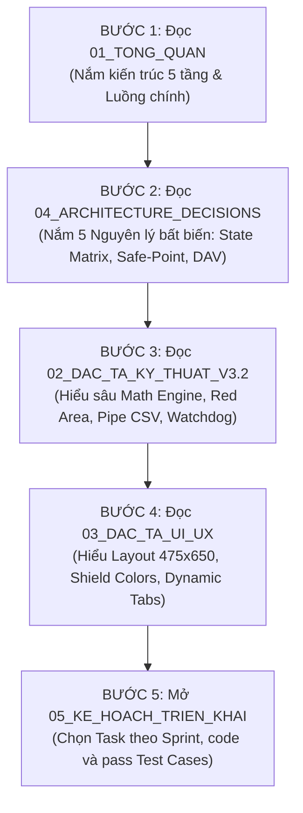

# 🧭 HƯỚNG DẪN BẮT ĐẦU: ĐỌC GÌ, HIỂU GÌ ĐỂ PHÂN TÍCH VÀ PHÁT TRIỂN TIẾP MYBOT

> **Dành cho:** Bất kỳ Developer hoặc Contributor mới tham gia dự án, muốn hiểu sâu kiến trúc bot game Clash of Clans (AutoIt3) và tham gia quá trình hiện đại hoá sang **C# .NET 8 WPF**.
>
> **Vị trí thư mục:** `docs/context/`

---

## 🗂️ BẢN ĐỒ TÀI LIỆU TRONG THƯ MỤC `docs/context/`

| STT | File Tài Liệu | Nội Dung Cốt Lõi | Mức Độ Ưu Tiên |
|:---:|---|---|:---:|
| **1** | [01_TONG_QUAN_KIEN_TRUC_MYBOT.md](file:///c:/Users/PC/Downloads/MyBot%20PHMOD%20v15.3/MyBot/docs/context/01_TONG_QUAN_KIEN_TRUC_MYBOT.md) | Bức tranh tổng quan, sơ đồ luồng hoạt động, cấu trúc mã nguồn AutoIt3 gốc | ⭐⭐⭐ (Đọc đầu tiên) |
| **2** | [02_DAC_TA_KY_THUAT_CHI_TIET_V3.2.md](file:///c:/Users/PC/Downloads/MyBot%20PHMOD%20v15.3/MyBot/docs/context/02_DAC_TA_KY_THUAT_CHI_TIET_V3.2.md) | **Kinh thánh kỹ thuật:** CSV Parser `\|`, Toạ độ Isometric, Red Area, Dead Base, Watchdog, DAV Pattern | ⭐⭐⭐⭐⭐ (Bắt buộc) |
| **3** | [03_DAC_TA_UI_UX_CHUAN_SOURCE.md](file:///c:/Users/PC/Downloads/MyBot%20PHMOD%20v15.3/MyBot/docs/context/03_DAC_TA_UI_UX_CHUAN_SOURCE.md) | Đặc tả 100% GUI gốc: 475×650px, Bottom Panel, 6 Hero Shields, 6 Main Tabs, Hệ thống Đa ngôn ngữ | ⭐⭐⭐⭐ (Đọc khi làm UI) |
| **4** | [04_QUYET_DINH_KIEN_TRUC_DUAL_LAYER.md](file:///c:/Users/PC/Downloads/MyBot%20PHMOD%20v15.3/MyBot/docs/context/04_QUYET_DINH_KIEN_TRUC_DUAL_LAYER.md) | 5 Quyết định kiến trúc bất biến (Dual-Layer: Khái niệm vs Implementation AutoIt / C# WPF) | ⭐⭐⭐⭐⭐ (Bắt buộc) |
| **5** | [05_KE_HOACH_TRIEN_KHAI_CSHARP_WPF_124_TASKS.md](file:///c:/Users/PC/Downloads/MyBot%20PHMOD%20v15.3/MyBot/docs/context/05_KE_HOACH_TRIEN_KHAI_CSHARP_WPF_124_TASKS.md) | **Kế hoạch triển khai V2.0:** 11 Phase / 16 Sprint / 145 Task chi tiết kèm Test Cases (Happy + Edge), fix triệt để dependency FSM và bổ sung đủ scope | ⭐⭐⭐⭐⭐ (Thực thi) |

---

## 🎯 LỘ TRÌNH ĐỌC & TIẾP CẬN DỰ ÁN (READING ROADMAP)

---

## 🧠 BẠN CẦN HIỂU NHỮNG GÌ? (5 TRỤ CỘT KIẾN THỨC CỐT LÕI)

### 1. Bản chất hệ toạ độ và cửa sổ Emulator
- Cửa sổ giả lập (LDPlayer, BlueStacks 5, MEmu, Nox) luôn được chuẩn hoá về vùng làm việc **860 × 732 logical pixels** (kích thước game thực 860 × 720 + thanh điều hướng 12px).
- Tuyệt đối không hardcode toạ độ theo màn hình vật lý, mọi phép tính đều tương đối theo Client Area của cửa sổ giả lập.
- Nắm vững công thức hình thoi Isometric 44×44 tiles chuyển đổi giữa toạ độ lưới `(u, v)` và toạ độ màn hình `(x, y)`.

### 2. Thuật toán thả quân & Kịch bản CSV (Combat Engine)
- **Ký tự phân cách bắt buộc là `|` (pipe)**, không phải dấu phẩy `,`! (Xem file `COCBot/functions/Attack/ParseAttackCSV.au3`).
- Thứ tự cột của lệnh `DROP`:
  `DROP | VectorID | IndexList | Quantity | TroopName | DelayPoints | DelayDrop | DelayEnd | [Jitter]`
- Cơ chế quét **Red Area** (đường biên cấm thả quân màu đỏ): Phân 4 góc phần tư bản đồ, lọc nhiễu outlier và nội suy thành vector polyline để thả quân.

### 3. Vòng tuần hoàn phát hiện & hành động: DAV Pattern (Detection - Action - Verification)
- Không bao giờ click "mù" rồi `Sleep()` cố định.
- Luôn chụp ảnh trước thao tác $\rightarrow$ Thực hiện Tap $\rightarrow$ Chụp ảnh sau thao tác (trong vòng 33ms–100ms) để verify xem trạng thái game có thay đổi không.
- Nếu không đổi thì retry; nếu đổi thì mới chuyển state. Điều này ngăn chặn 100% tình trạng "double click", trễ mạng hoặc kẹt nút Next.
- Khi chạy Replay Test: DAV Executor tự động chuyển sang chế độ **Bypass Verification**, ghi nhận action vào `MockInput` và tua nhanh 10x mà không sleep.

### 4. Quản lý trạng thái & Safe-Point Pause
- Hệ thống có **10 States chuẩn**: `IDLE`, `STARTING`, `SEARCHING`, `BATTLE`, `COLLECTING`, `UPGRADING`, `PAUSING`, `PAUSED`, `RESUMING`, `STOPPING`, `ERROR`.
- Chuyển state phải thông qua **Transition Guard Matrix** (chặn các bước nhảy vô lý như `IDLE` nhảy thẳng vào `BATTLE`).
- **Safe-Point Pause:** Khi người dùng bấm nút Pause, bot không bao giờ dừng đột ngột giữa chừng khi đang thả dở wave lính hoặc đang trong trận. Bot chuyển sang state `PAUSING`, hoàn tất thao tác an toàn hiện tại, sau đó mới chính thức chuyển `PAUSED`.

### 5. Hệ thống giám sát (Watchdog) & Anti-ban 24/7
- 3 tiến trình hoạt động song song: `MyBot.run.exe` (Chính), `Watchdog.exe` (Giám sát qua Named Pipe/Mutex), `Wmi.exe` (Quản trị tiến trình giả lập).
- Mỗi state có một hạn mức timeout riêng (ví dụ: Search mây tối đa 60s, Thả quân tối đa 180s). Quá hạn $\rightarrow$ Kích hoạt chuỗi Panic Recovery (tự khởi động lại giả lập).
- Cơ chế Anti-ban: Phân phối độ trễ Gaussian (Box-Muller transform), đường cong chuột Bezier có xác suất overshoot 8%, độ phân tán toạ độ click trong Bounding Box và lịch ngủ sinh học (Circadian Sleep).

---

## 🔍 BẢNG TRA CỨU ĐỐI CHIẾU MÃ NGUỒN AUTOIT GỐC

Khi bạn implement các task C# WPF trong [05_KE_HOACH_TRIEN_KHAI_CSHARP_WPF_124_TASKS.md](file:///c:/Users/PC/Downloads/MyBot%20PHMOD%20v15.3/MyBot/docs/context/05_KE_HOACH_TRIEN_KHAI_CSHARP_WPF_124_TASKS.md), hãy mở các file AutoIt tương ứng để đối chiếu ground truth:

| Module Logic C# | File AutoIt3 tương ứng trong repo | File C++ / DLL gốc |
|---|---|---|
| **Capture & Window** | `COCBot/functions/Android/Android.au3`, `Android_Win32.au3` | `lib/MyBot.dll` |
| **Input (PostMessage/ADB)** | `COCBot/functions/Android/Android_Win32_PostMessage.au3` | Win32 API `user32.dll` |
| **State Classification** | `COCBot/functions/Main Screen/CheckMainScreen.au3`, `CheckState.au3` | `lib/MyBot.dll` |
| **Isometric Coordinates** | `COCBot/functions/Attack/ConvertInternalExternArea.au3` | Thuật toán toán học thuần |
| **Red Area Detection** | `COCBot/functions/Attack/_GetRedArea.au3`, `RedLines.au3` | `lib/FastFind.dll` |
| **Dead Base Check** | `COCBot/functions/Attack/DeadBase.au3`, `hasElixirStorage.au3` | Image Search templates |
| **CSV Attack Parser** | `COCBot/functions/Attack/ParseAttackCSV.au3`, `AttackCSV.au3` | File `.csv` trong `CSV/` |
| **Troop Drop Executor** | `COCBot/functions/Attack/DropTroop.au3`, `SmartAttack.au3` | Input simulation |
| **Watchdog & Recovery** | `MyBot.run.Watchdog.au3`, `COCBot/functions/Watchdog/*.au3` | Windows IPC |
| **Main GUI & 6 Tabs** | `COCBot/GUI/MBR GUI Design.au3`, `MBR GUI Design Tab *.au3` | AutoIt GUI Controls |
| **I18N Language** | `COCBot/functions/Multilanguage/GetTranslatedFileIni.au3` | File INI trong `Languages/` |

---

## 🚀 QUY TRÌNH BẮT ĐẦU SPRINT 1 (PHASE 0)

Để bắt đầu làm việc ngay:
1. Mở [05_KE_HOACH_TRIEN_KHAI_CSHARP_WPF_124_TASKS.md](file:///c:/Users/PC/Downloads/MyBot%20PHMOD%20v15.3/MyBot/docs/context/05_KE_HOACH_TRIEN_KHAI_CSHARP_WPF_124_TASKS.md) $\rightarrow$ Xem mục **PHASE 0 — SOLUTION FOUNDATION**.
2. Thực hiện tuần tự 8 task đầu tiên:
   - `T0.1`: Tạo solution `MyBot.sln`, `Directory.Build.props` và 15+ projects.
   - `T0.2`: Định nghĩa các Interfaces cốt lõi trong `MyBot.Core`.
   - `T0.3`: Thiết lập DI Container (`Microsoft.Extensions.DependencyInjection`).
   - `T0.4`: Cấu hình Serilog (Console, Rolling File, RichTextBox sink).
   - `T0.5`: Cấu hình JSON Config Manager với Schema Validation.
   - `T0.6`: Thiết lập CI/CD GitHub Actions chạy trên Ubuntu (với mock replay test).
   - `T0.7`: Khởi tạo documentation ADR từ file `04_QUYET_DINH_KIEN_TRUC_DUAL_LAYER.md`.
   - `T0.8`: Tạo CLI tool `record_session` ghi hình FFV1 + telemetry để phục vụ test framework.
3. Mỗi task tạo 1 Git branch riêng (ví dụ `feature/T0.1-solution-structure`), viết mã nguồn, viết Unit Test tương ứng để đạt **100% pass các Test Cases** quy định trước khi merge.
